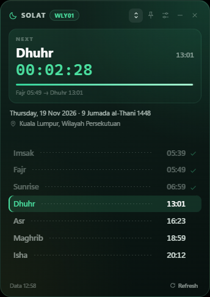

# Solat Widget

**English** · [Bahasa Melayu](README.ms.md)



Malaysian prayer times on your Windows desktop, built with Electron. Times come
straight from the **JAKIM e-Solat** API and are shown in a small glass card that
floats above other windows.


## Documentation

- [Architecture reference](docs/ARCHITECTURE.md) — modules, flows, IPC and cache design
- [User manual](docs/USER-MANUAL.md) — installation, settings, tray, troubleshooting
- Screenshots: [`docs/images/`](docs/images/)

## Features

- Today's prayer times plus a live countdown to the next prayer
- Automatic JAKIM zone detection from your network location (60 zones, manual override)
- Hijri date, Imsak and Syuruk (both can be hidden)
- Reminder notification before the adhan (0–30 minutes, configurable)
- Frameless always-on-top card, drag it anywhere, position is remembered
- Hides to the system tray; the tooltip shows the live countdown
- Optional "start with Windows"
- Local cache — the widget keeps working if JAKIM cannot be reached
- Packages to `.exe` (portable build + installer)

## Requirements

- Windows 10/11
- Node.js 18+ (for development)

## Development

```bash
npm install
npm start        # run the widget
npm run dev      # run with DevTools
npm run icons    # regenerate the icons in assets/
```

## Build

```bash
npm run dist
```

Output in `dist/`:

- `SolatWidget-1.0.0-portable.exe` — run it directly, no installation
- `Solat Widget Setup 1.0.0.exe` — installer (choose a folder, desktop shortcut)

> Builds are not code-signed, so Windows SmartScreen may show an
> "unknown publisher" warning the first time you run them.

## Data source

| Item | Value |
|---|---|
| API | `https://www.e-solat.gov.my/index.php?r=esolatApi/takwimsolat` |
| Parameters | `period=month` (plus `period=week` in the last two days of a month), `zone=<zone code>`, `lang=ms_my` |
| Default zone | Detected from your IP; falls back to `WLY01` (Kuala Lumpur/Putrajaya) |
| Cache | `%APPDATA%/solat-desktop-widget/data/` — 6 h for the month cache, 1 h for the week cache |
| Config | `%APPDATA%/solat-desktop-widget/config.json` |

The API is not officially documented. If JAKIM changes the response format, the
widget keeps showing the last cached data until the code is updated.

## Project layout

```
src/
  main/       Electron main process (window, tray, scheduler, API)
  preload/    secure IPC bridge (contextIsolation)
  renderer/   widget card UI (plain HTML/CSS/JS)
  shared/     prayer logic shared by main and renderer
assets/       app and tray icons
scripts/      icon generator
```

## Notes

- If the device timezone is not UTC+8, prayer times are displayed in Malaysian
  time and marked "waktu MYT" in the status bar.
- IP location is only city-level; near state borders, pick a zone manually with
  the zone button in the top-left corner.

## Build stats

Figures from the session that produced v1.0.0 (14 November 2026).

| | |
|---|---|
| Working time | 2 h 53 min wall-clock · 1 h 51 min model-active |
| Tokens processed | 17.9 M — 609 k input · 91 k output (88 k reasoning) · 17.2 M cache reads |
| Model cost | $0.00 (free tier) |
