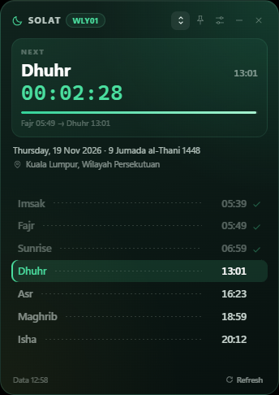

# Solat Widget

[English](README.md) · **Bahasa Melayu**



Widget waktu solat Malaysia untuk desktop Windows, dibina dengan Electron.
Data diambil terus daripada **JAKIM e-Solat** dan dipaparkan dalam kad kecil
yang sentiasa di atas desktop.


## Dokumentasi

- [Architecture reference](docs/ARCHITECTURE.md) — modules, flows, IPC and cache design
- [User manual](docs/USER-MANUAL.md) — installation, settings, tray, troubleshooting
- Screenshots: [`docs/images/`](docs/images/)

## Ciri

- Waktu solat hari ini + kiraan detik ke solat seterusnya
- Zon JAKIM dikesan automatik daripada lokasi rangkaian (boleh tukar manual, 60 zon)
- Tarikh Hijri, Imsak & Syuruk (boleh sembunyi)
- Notifikasi sebelum azan (0–30 minit, boleh laras)
- Kad tanpa bingkai, sentiasa di atas, boleh diseret, disimpan posisinya
- Sembunyi ke system tray, tooltip tray tunjuk kiraan detik
- Mula bersama Windows (pilihan)
- Cache setempat — widget tetap berfungsi walaupun JAKIM tidak dapat dihubungi
- Bina menjadi `.exe` (portable + installer)

## Keperluan

- Windows 10/11
- Node.js 18+ (untuk pembangunan)

## Pembangunan

```bash
npm install
npm start        # jalankan widget
npm run dev      # jalankan dengan DevTools
npm run icons    # jana semula ikon dalam assets/
```

## Bina

```bash
npm run dist
```

Hasil dalam `dist/`:

- `SolatWidget-1.0.0-portable.exe` — jalankan terus tanpa pemasangan
- `Solat Widget Setup 1.0.0.exe` — installer (pilihan folder, shortcut desktop)

> Build tidak ditandatangani secara digital, jadi Windows SmartScreen mungkin
> memaparkan amaran "unknown publisher" pada kali pertama.

## Sumber data

| Perkara | Nilai |
|---|---|
| API | `https://www.e-solat.gov.my/index.php?r=esolatApi/takwimsolat` |
| Parameter | `period=month` (dan `period=week` pada dua hari terakhir bulan), `zone=<kod zon>`, `lang=ms_my` |
| Zon lalai | Dikesan melalui IP; jika gagal `WLY01` (Kuala Lumpur/Putrajaya) |
| Cache | `%APPDATA%/solat-desktop-widget/data/` — 6 jam untuk cache bulan, 1 jam untuk cache minggu |
| Konfigurasi | `%APPDATA%/solat-desktop-widget/config.json` |

API ini tidak didokumenkan secara rasmi. Jika JAKIM menukar format respons,
widget akan memaparkan data cache terakhir sehingga kod dikemas kini.

## Struktur

```
src/
  main/       proses utama Electron (tetingkap, tray, penjadual, API)
  preload/    jambatan IPC yang selamat (contextIsolation)
  renderer/   UI kad widget (HTML/CSS/JS biasa)
  shared/     logik solat yang dikongsi main & renderer
assets/       ikon aplikasi & tray
scripts/      penjana ikon
```

## Nota

- Jika zon waktu peranti bukan UTC+8, masa solat dipaparkan dalam waktu Malaysia
  dan ditanda "waktu MYT" pada bar status.
- Lokasi IP hanya tepat pada peringkat bandar; untuk sempadan negeri, pilih zon
  secara manual melalui butang zon di penjuru kiri atas.

## Statistik bina

Angka daripada sesi yang menghasilkan v1.0.0 (14 November 2026).

| | |
|---|---|
| Masa kerja | 2 jam 53 minit (jam dinding) · 1 jam 51 minit aktif |
| Token diproses | 17.9 juta — 609 ribu input · 91 ribu output (88 ribu penaakulan) · 17.2 juta bacaan cache |
| Kos model | $0.00 (tahap percuma) |
