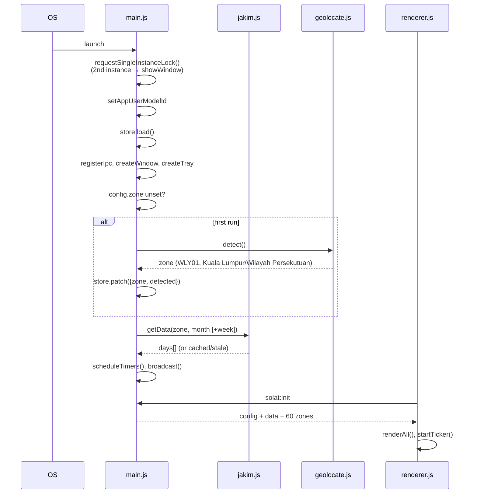
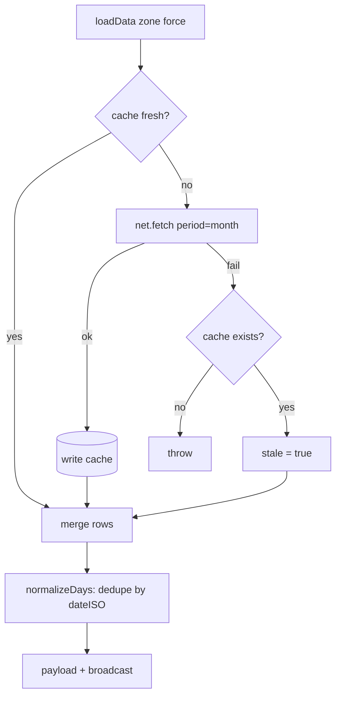

# Solat Widget — Architecture Reference

Technical reference for **Solat Widget v1.1.0**, an Electron desktop widget that
shows Malaysian prayer times sourced from the JAKIM e-Solat API.

For the end-user view of the same app, see [`USER-MANUAL.md`](./USER-MANUAL.md).

---

## 1. Overview

| | |
|---|---|
| **Platform** | Windows 10/11 (x64) |
| **Runtime** | Electron 45.3.2 (Chromium + Node 22 inside the main process) |
| **Language** | Plain JavaScript, CommonJS — no framework, no bundler, no transpilation |
| **Data source** | `https://www.e-solat.gov.my/index.php?r=esolatApi/takwimsolat` (unofficial) |
| **Location source** | Public IP geolocation, 3-provider fallback chain |
| **Packaging** | electron-builder 26.18 → portable `.exe` + NSIS installer |
| **Source of truth for times** | The device clock (`Date`), not `serverTime` |

Design rules the codebase follows:

1. **No build step.** Every file is directly loadable; `shared/solat-core.js` is a
   UMD wrapper so the exact same code runs in Node and in the browser.
2. **Renderer has no network or disk access.** Everything crosses a narrow IPC
   surface exposed by the preload script.
3. **The widget is a viewer.** All scheduling, caching and retry logic lives in
   the main process; the renderer only ticks the clock and repaints.
4. **Every user-facing string is translatable.** Text lives in
   `shared/i18n.js`, never inline in the UI. English is the default; Malay is
   a full second locale.

---

## 2. Runtime topology

```
┌─────────────────────────────────────────────────────────────────┐
│ Electron main process (Node 22)                                 │
│                                                                 │
│   main.js ── jakim.js ── e-Solat API (HTTPS)                    │
│      │          └── %APPDATA%/…/data/*.json   (disk cache)      │
│      ├── geolocate.js ── ipwho.is / ipapi.co / ip-api.com        │
│      ├── zones.js      (static 60-zone table, in-process)       │
│      ├── store.js      ── %APPDATA%/…/config.json               │
│      ├── shared/solat-core.js  (pure functions)                 │
│      ├── shared/i18n.js        (en/ms string tables)            │
│      └── Tray, BrowserWindow, Notification, timers              │
│                        │  IPC  ▲                                │
│                        ▼  │                                     │
├─────────────────────────────────────────────────────────────────┤
│ Preload (isolated world)      preload.js                        │
│   contextBridge.exposeInMainWorld('solat', { … })                │
├─────────────────────────────────────────────────────────────────┤
│ Renderer (sandboxed Chromium, no Node)                          │
│   index.html + styles.css + renderer.js                         │
│   shared/solat-core.js + shared/i18n.js  (plain <script>)        │
└─────────────────────────────────────────────────────────────────┘
```

### Security model

| Setting | Value | Why |
|---|---|---|
| `contextIsolation` | `true` | Preload and page cannot see each other's globals |
| `nodeIntegration` | `false` | The page cannot touch Node/fs/network |
| `sandbox` | `true` | Preload only gets `require('electron')` |
| CSP | `default-src 'self'; script-src 'self'; style-src 'self' 'unsafe-inline'; img-src 'self' data:; connect-src 'none'` | Blocks any remote code/asset; `connect-src 'none'` is meaningful because all network I/O happens in main |
| `setWindowOpenHandler` | deny + `shell.openExternal` for http(s) | No popups, no in-app browsing |
| `will-navigate` | prevented | The page is a static file |

`app.setAppUserModelId('com.solatwidget.widget')` is set early because Windows
will not show `Notification` toasts for an unknown AppUserModelID.

---

## 3. Folder map

```
solat-desktop-widget/
├─ package.json            scripts + electron-builder "build" config
├─ README.md               quick start (English, default)
├─ README.ms.md            quick start (Bahasa Melayu)
├─ docs/
│  ├─ ARCHITECTURE.md      this file
│  ├─ USER-MANUAL.md       how to use the widget
│  └─ images/              embedded screenshots
├─ assets/
│  ├─ icon.ico             multi-size app icon (exe + shortcuts)
│  ├─ icon-256.png         window/notification icon
│  └─ tray-16/20/32.png    tray glyphs
├─ scripts/
│  └─ make-icons.sh        regenerates assets/ via ImageMagick
└─ src/
   ├─ main/
   │  ├─ main.js           window, tray, IPC, scheduling, lifecycle
   │  ├─ jakim.js          e-Solat HTTP client + cache
   │  ├─ geolocate.js      IP → approximate location → zone
   │  ├─ zones.js          static JAKIM zone table + matching
   │  └─ store.js          JSON config persistence
   ├─ preload/preload.js   contextBridge → window.solat
   ├─ renderer/
   │  ├─ index.html        single card + settings sheet
   │  ├─ styles.css        all styling (glass card, sheet, compact mode)
   │  └─ renderer.js       rendering + 500 ms ticker
   └─ shared/
      ├─ solat-core.js     prayer math used by both sides
      └─ i18n.js           en/ms UI strings + interpolation
```

---

## 4. Module reference

There are **no ES classes** in this project. Each module is a set of pure
functions over a module-scoped state object. This section documents each module
the way a class reference would: responsibility, internal state, public API,
callers, and failure behaviour.

### 4.1 `src/shared/solat-core.js` — prayer-time math

Runs in **both** processes (UMD: `module.exports` in main, `window.SolatCore` in
the renderer). Pure — no I/O, no Electron.

**Constants**

| Export | Value | Meaning |
|---|---|---|
| `ALL_KEYS` | `imsak, fajr, syuruk, dhuha, dhuhr, asr, maghrib, isha` | Keys exactly as JAKIM returns them |
| `PRAYER_KEYS` | `fajr, dhuhr, asr, maghrib, isha` | The five that count as prayers |
| `DISPLAY_KEYS` | `imsak, fajr, syuruk, dhuhr, asr, maghrib, isha` | What the widget lists (`dhuha` is hidden) |
| `LABELS` | `fajr → Subuh`, `dhuhr → Zohor`, … | Malay display names (legacy alias) |
| `labels(lang)` | → `{fajr, dhuhr, …}` | Localised names: `Fajr/Dhuhr/Asr/Isha` in `en` (default), `Subuh/Zohor/Asar/Isyak` in `ms` |
| `WEEKDAYS` / `MONTHS_SHORT` / `HIJRI` | `{en, ms}` tables | Localised date and Hijri month names |
| `MYT_OFFSET_MINUTES` | `480` | UTC+8 |

**API**

| Function | Input → Output | Notes |
|---|---|---|
| `parseApiDate` | `"14-Nov-2026"` → `{y,m,d}` | Own month table; never `new Date(string)` |
| `parseApiTime` | `"05:48:00"` → `{h,m,s}` | Seconds optional |
| `buildDate(dateISO, time, asMYT)` | → `Date` | `asMYT=false` → device-local wall clock; `asMYT=true` → constructed as UTC and shifted −8 h, i.e. an absolute instant for a Malaysian clock time |
| `normalizeRow(row, asMYT)` | API row → `{dateISO, hijri, weekday, times{8 keys}, asMYT}` | |
| `normalizeDays(rows, asMYT)` | array → sorted array | **Dedupes by `dateISO`** (later rows win) — this is how `month` + `week` responses merge |
| `prayerEvents(days, lang)` | → `[{key,label,dateISO,at}]` sorted | Only the 5 prayers, every day present in the data |
| `scheduleFor(days, now, lang)` | → schedule object | The core query — see §5.3 |
| `formatCountdown(ms)` | → `"02:09:32"` | Padded `HH:MM:SS` |
| `formatTime(timeStr, {hour12, lang})` | → `"18:58"` or `"6:58 PM"` / `"6:58 PTG"` | 12-hour suffix follows the locale |
| `formatDateLong(date, lang)` | → `"Thursday, 19 Nov 2026"` / `"Khamis, 19 Nov 2026"` | Localised weekday/month names |
| `formatHijri(str, lang)` | `"1448-06-04"` → `"4 Jumada al-Thani 1448"` / `"4 Jamadilakhir 1448"` | |
| `isMalaysiaTime(date)` | → boolean | `date.getTimezoneOffset() === -480` |

### 4.2 `src/main/zones.js` — the zone table and matching

Internal state: two module-level maps — `STATES` (3-letter state prefix → state
name) and `ZONES` (all 60 zones, each enriched with `state`, `stateCode`, and an
approximate `lat/lon` centroid).

| Function | Purpose |
|---|---|
| `byCode(code)` | O(1) lookup; returns `null` for unknown codes |
| `minimal()` | The 60 zones as `{code,state,label}` — sent once to the renderer for the picker |
| `search(q)` | Text search over `code + state + label` |
| `displayName(code)` | `"WLY01 · Kuala Lumpur, Putrajaya"` |
| `stateFromName(name)` | `"Wilayah Persekutuan"` → `"WLY"`; n-gram aliases (`penang` → `PNG`, `wp kuala lumpur` → `WLY`) |
| `normalizeText(s)` | Lowercase, strip non-alphanumerics, collapse spaces |
| `distanceKm(...)` | Haversine |
| `labelTokens(zone)` | Zone label minus stopwords (`kuala`, `hulu`, `bandar`, `jaya`, …) and words < 4 chars |
| `pickZone(geo)` | The location→zone decision — see §5.4 |

### 4.3 `src/main/store.js` — configuration persistence

Internal state: `filePath` (`%APPDATA%/solat-desktop-widget/config.json`), `data`
(merged defaults), `saveTimer` (250 ms debounce).

| Function | Notes |
|---|---|
| `load()` | Read + merge over `DEFAULTS`; corrupt/missing file silently resets |
| `all()` | Lazy-loads, returns the live object |
| `get(key)` / `set(key, value)` | |
| `patch(obj)` | **Only keys present in `DEFAULTS` are accepted** — this is the whitelist behind the IPC boundary |
| `flush()` | Write to `config.json.tmp` then rename (atomic on Windows) |
| `scheduleSave()` | 250 ms debounce; `unref()`-ed so it cannot hold the process open |

### 4.4 `src/main/jakim.js` — the e-Solat client

Internal state: none; state lives on disk.

**Constants**: `TIMEOUT_MS = 15 000`, `MONTH_TTL_MS = 6 h`, `RETRIES = 3`,
User-Agent `SolatWidget/1.0`.

| Function | Behaviour |
|---|---|
| `request(zone, period)` | `net.fetch` (respects the Windows proxy), 3 attempts with 600 ms/1.2 s backoff, `AbortSignal.timeout`. Throws on non-200, non-JSON, or JAKIM's error shape `{"status":"NO_RECORD!"}` (JAKIM 404s a bad zone with HTTP 200, so the body is validated, not the status code) |
| `getPeriod(zone, period, opts)` | Returns `{payload, cached, stale, error?}`. Cache hit within TTL → no request; on network failure, falls back to any cache and flags `stale` |
| `getData(zone, {force})` | Orchestrates: always fetches `period=month`; **adds `period=week` when the day of month is ≥ lastDay−2** because JAKIM's month endpoint never returns next month, and the week call is what covers tomorrow's Fajr after Isha. Merges both payloads via `normalizeDays` (dedupe by `dateISO`). Result: `{zone, days, asMYT, stale, fromCache, serverTime, fetchedAt, error}` |

Cache files live in `<userData>/data/` — deliberately *not* `<userData>/cache`,
which collides with Chromium's own HTTP-cache directory.

### 4.5 `src/main/geolocate.js` — IP → location

Internal state: none. `PROVIDERS` is an ordered array; each entry knows how to
normalise its own JSON shape.

| Function | Behaviour |
|---|---|
| `lookup()` | Tries `ipwho.is` → `ipapi.co` → `ip-api.com`, 10 s timeout each; first success wins. Returns `{country, region, city, lat, lon, provider}` or `null` |
| `detect()` | Wraps `lookup()`: returns `{geo, zone, via, reason}` where `reason` is one of `ok`, `offline`, `outside-malaysia` (country ≠ MY), `no-match` |

No API key is used, and the accuracy is city-level — this is only a *default*
zone, always overridable.

### 4.6 `src/main/main.js` — the app shell

Internal state:

```js
const state = { data, error, geoError, loading }  // last known dataset
let win            // BrowserWindow
let tray           // Tray
let timers = []    // all scheduled setTimeout handles
let tooltipTimer   // tray tooltip refresher
let lastNotified   // in-memory dedupe, mirrors config.lastNotified
const isQuitting   // lets win.on('close') hide instead of quitting
```

**Window** — one of two fixed sizes from `SIZES`: `normal` = 344 × 486,
`compact` = 344 × 150. Frameless and transparent (`frame:false`,
`transparent:true`), `resizable:false`, `skipTaskbar:true`, `hasShadow:false`,
`alwaysOnTop` per config, `show:false` until `ready-to-show`. Position comes
from `config.bounds`, validated by `clampToDisplays(bounds, size)` (rejects
coordinates more than 200 px off-screen — this is what saves you after a
monitor change), else `defaultPosition(size)` = bottom-right of the primary
work area. `applyWindowSize(mode)` switches presets at runtime with the same
clamping logic and persists the new position.

**Tray** — `click` toggles the window; `right-click` pops a menu built fresh by
`buildTrayMenu()` (next-prayer line, refresh, compact size, pin, autostart,
notifications, quit). Every label goes through `t(key)` → `i18n.t(key,
config.lang)`, so the tray, tooltip and notifications follow the UI language.
`updateTooltip()` runs every 20 s and sets `"<next prayer> HH:MM (HH:MM:SS)"`.

**Data** — `loadData({zone, force, reason})` sets `state.loading`, calls
`jakim.getData`, records the result or an error, calls `scheduleTimers()` and
`broadcast()` (payload → `solat:update`).

**Notifications** — `scheduleTimers()` clears all timers and re-arms:

- one timer per upcoming prayer at `azan − notifyLead` minutes (skipped beyond
  a 30 h horizon),
- one timer at `00:00:25` local to force a data refresh for the new date.

`fire(ev)` dedupes on `dateISO|key|notifyLead` (also stored in config so a
restart cannot re-fire the same adhan), then `showAdhanNotification()` shows a
toast; clicking it focuses the widget.

**Preference application** — `applyPref(patch)` is whitelisted through
`PREF_SCHEMA` (`alwaysOnTop, showImsak, showSyuruk, hour12, notifyEnabled,
notifyLead, autoLaunch, windowSize, lang`). Booleans are coerced, numbers are
clamped (`notifyLead` 0–60), and enums are validated (`windowSize` ∈
`normal|compact`, `lang` ∈ `en|ms`). Side effects: `setAlwaysOnTop`,
`applyWindowSize`, `applyAutoLaunch` (`app.setLoginItemSettings`, packaged
builds only), and re-scheduling.

### 4.7 `src/preload/preload.js` — the IPC bridge

Exposes exactly one object, `window.solat`:

| Method | Maps to | Direction |
|---|---|---|
| `init()` | `solat:init` (invoke) | renderer → main |
| `refresh()` | `solat:refresh` (invoke) | renderer → main |
| `setZone(code)` | `solat:setZone` (invoke) | renderer → main |
| `detect()` | `solat:detect` (invoke) | renderer → main |
| `setPref(patch)` | `solat:setPref` (invoke) | renderer → main |
| `openExternal(url)` | `solat:openExternal` (invoke) | renderer → main |
| `hide()` / `quit()` | `solat:hide` / `solat:quit` (send) | renderer → main |
| `onUpdate(cb)` | subscribes to `solat:update` | main → renderer |

### 4.8 `src/renderer/renderer.js` — the UI

Internal state:

```js
const state = { config, data, error, geoError, loading, zones,
                isPackaged, version }
let rowEls    // Map: prayer key → <li>, rebuilt only when rows change
let sheetOpen, refreshing
let tickTimer, lastTodayISO, leadLang
```

Two small helpers sit on top: `lang()` resolves `config.lang` to `en`/`ms`
(default `en`), and `t(key, vars)` delegates to `SolatI18n.t`.

**Render pipeline** (all triggered by `renderAll()`, which is called on boot and
on every `solat:update`):

```
renderAll()
 ├─ applyStaticText()    data-i18n / data-i18n-title / data-i18n-placeholder
 ├─ renderSize()         body[data-size] + compact button state
 ├─ renderZoneChip()     header chip (code + tooltip)
 ├─ renderLocation()     detected city, else zone label
 ├─ renderPin()          pressed state on the pin button
 ├─ renderTimes()        rebuilds the prayer <li> list
 ├─ renderHero(sched)    next prayer, time, countdown, progress, "prev → next"
 ├─ renderRowStates()    .past / .next classes on rows
 ├─ renderMeta()         "Thursday, 19 Nov 2026 · 9 Jumada al-Thani 1448"
 ├─ renderStatus()       "Data 16:25 · cache · offline · MYT time" + badges
 └─ syncPrefs()          settings sheet checkboxes/selects (+ language options)
```

`tick()` runs every 500 ms and is the only recurring DOM writer. It recomputes
`currentSchedule()` (≈ 150 events — cheap), updates the countdown/progress/
row states, and on a date change (tracked via `lastTodayISO`) calls
`requestRefresh()` so the main process refetches for the new day.

`rowEls` is rebuilt by `renderTimes()`; every other render path only mutates
classes and text, so the list DOM is stable.

Compact mode is a pure presentation switch: `body[data-size="compact"]` hides
`.meta`, `.times`, `.foot`, `.progress` and `.hero-foot`, while the rest of the
hero (eyebrow, prayer name, time, countdown) stays. The renderer keeps
updating the hidden nodes so switching back is instant. `openSheet()` first
expands a compact card to `normal`, because the settings sheet needs the full
486 px height.

### 4.9 `src/renderer/index.html` + `styles.css` — the component map

| Region | Element ids | Styling hook |
|---|---|---|
| Card (drag surface) | `card` | `.card` — rounded glass, radial highlights |
| Header | `zoneChip`, `btnSize`, `btnPin`, `btnSettings`, `btnMin`, `btnClose` | `.bar`, `.chip`, `.icon-btn` |
| Next-prayer hero | `nextEyebrow`, `tomorrowBadge`, `staleBadge`, `nextName`, `nextAt`, `countdown`, `progressFill`, `heroFoot` | `.hero` |
| Date + location | `dateLine`, `locText` | `.meta` |
| Prayer list | `times` (dynamic `<li class="row">`) | `.row`, `.past`, `.next` |
| Footer | `status`, `btnRefresh` | `.foot` |
| Settings overlay | `sheet`, `zoneSearch`, `zoneList`, `btnDetect`, `prefNotify`, `prefLead`, `prefTop`, `prefImsak`, `prefSyuruk`, `prefHour12`, `prefCompact`, `prefLang`, `prefAuto`, `autoHint`, `versionText`, `btnHide`, `btnQuit` | `.sheet`, `.group`, `.toggle` |

Drag behaviour is CSS-only: `.card { -webkit-app-region: drag }` with every
control opted out via `no-drag`. Translateable markup carries `data-i18n`,
`data-i18n-title` or `data-i18n-placeholder`; `body[data-size="compact"]` is
the compact layout hook.

### 4.10 `src/shared/i18n.js` — UI strings

UMD module (CommonJS in main, `window.SolatI18n` in the renderer), loaded by the
main process and by a plain `<script>` before `renderer.js`.

| Export | Shape | Notes |
|---|---|---|
| `LANGS` | `[{code:'en',label:'English'}, {code:'ms',label:'Bahasa Melayu'}]` | Builds the language picker |
| `STRINGS` | `{en:{…}, ms:{…}}` | Flat key tables (`card.*`, `settings.*`, `tray.*`, `notify.*`, `error.*`) |
| `t(key, lang, vars)` | → string | Falls back to `en`, then to the key itself; replaces `{name}` placeholders from `vars` |

Missing translations are visible rather than silent: an unknown key renders as
its own key name, and a missing Malay string falls back to English. The
renderer applies tables declaratively through `data-i18n`,
`data-i18n-title` and `data-i18n-placeholder` attributes, so static markup has
no hard-coded copy.

---

## 5. Flows

### 5.1 Startup



Notes:

- The window is created **before** geolocation so the card appears immediately
  (in a "Fetching data…" state) even if the IP lookup is slow.
- If `detect()` fails, `zone` falls back to `WLY01` and the reason is surfaced
  to the renderer as `geoError`.
- `app.on('window-all-closed')` is a no-op: hiding the last window keeps the
  app alive in the tray.

### 5.2 Data fetch & cache



| Cache key | TTL | Contains |
|---|---|---|
| `WLY01-month-2026-11.json` | 6 h | the full current month |
| `WLY01-week.json` | 1 h | today ± 7 days, only fetched on the last two days of a month |

Merging is by `dateISO` dedupe, later rows winning — so the `week` rows (which
include tomorrow) overlay the month rows without conflict, and a stale month
cache cannot shadow fresh week data.

### 5.3 "Next prayer" computation

`scheduleFor(days, now, lang)`:

1. `prayerEvents(days, lang)` flattens **every day in the dataset** × 5 prayers
   into a sorted array of absolute `Date`s, labelling each event in the UI
   language.
2. The first event with `at > now` is `next`; the one before it is `prev`
   (so before today's Fajr, `prev` is yesterday's Isha — that is what makes
   the progress bar meaningful at 4 a.m.).
3. `progress = (now − prev.at) / (next.at − prev.at)`, clamped 0–1.
4. `isTomorrow` = `next.dateISO !== todayISO` → drives the `Tomorrow` badge.

Why the whole month instead of just today: after Isha the next prayer is
tomorrow's Fajr, which is not in today's row. Before Fajr, "yesterday's Isha"
is needed for the progress bar. Flattening the month once per tick is ~150
objects — cheaper than keeping incremental state coherent.

### 5.4 Location detection

```
IP lookup (ipwho.is → ipapi.co → ip-api.com)
  └─ country ≠ MY ─────────────► reason: outside-malaysia, keep current zone
  └─ stateFromName(region) ────► state code (e.g. Wilayah Persekutuan → WLY)
        ├─ city token ∈ zone label tokens (state pool only) ─► via "name"
        ├─ nearest centroid, +80 km penalty outside the state ─► via "distance"
        └─ first zone of the state ────────────────────────────► via "state"
  └─ lookup failed ────────────► reason: offline, fall back to WLY01
```

The `+80 km` penalty is what keeps a city near a border inside its own state's
zone list instead of jumping to the neighbouring state.

### 5.5 Zone change (user picks a zone)

```
renderer: chooseZone(code)
  → ipcRenderer.invoke('solat:setZone', code)
main: zones.byCode() validates → store.patch({zone})
      → loadData({zone, reason:'zone'})
      → scheduleTimers() + broadcast()
renderer: applyUpdate(payload) → renderAll()   ← full rebuild, not a diff
```

The renderer deliberately re-renders *everything* on every update. An earlier
version diffed on a signature that did not include the zone, and the prayer
rows kept showing the previous zone's times after a zone switch — so the
signature optimisation was removed. Updates are rare; correctness is cheap.

### 5.6 Day rollover & refresh

| Trigger | Mechanism |
|---|---|
| Midnight | Timer at `00:00:25` → `loadData({force:true})` |
| Safety net | `setInterval` every 3 h → forced refresh (also covers a laptop waking from sleep) |
| Renderer fallback | `tick()` notices `toISODate(now) !== lastTodayISO` and calls `requestRefresh()` |
| Manual | Tray menu, `Refresh` button |

Three redundant mechanisms on purpose: sleep/hibernate can silently skip any
single one of them.

---

## 6. IPC contract

| Channel | Type | Request | Response / payload | Side effects |
|---|---|---|---|---|
| `solat:init` | invoke | — | `{config, data, error, geoError, loading, isPackaged, version, zones[60], platform}` | none |
| `solat:refresh` | invoke | — | dataset or throws | forced refetch + reschedule |
| `solat:setZone` | invoke | `code` | dataset or throws `"Invalid zone: …"` | config write + refetch |
| `solat:detect` | invoke | — | `{ok, zone?, detected?, reason?}` | config write + refetch |
| `solat:setPref` | invoke | `{key: value}` | updated config or throws | whitelisted patch + side effects |
| `solat:openExternal` | invoke | `url` | — | `shell.openExternal` if http(s) |
| `solat:hide` / `solat:quit` | send | — | — | hide window / quit |
| `solat:update` | event (main → renderer) | — | `{config, data, error, geoError, loading, isPackaged, version}` | — |

Validation is at the boundary: `setZone` resolves through `zones.byCode`,
`setPref` through the `DEFAULTS`/`PREF_SCHEMA` whitelist. Everything from the
renderer is treated as untrusted input.

---

## 7. Configuration schema

`%APPDATA%/solat-desktop-widget/config.json`

| Key | Type | Default | Meaning |
|---|---|---|---|
| `zone` | `string` | `null` → auto-detect | JAKIM zone code |
| `detected` | `object` | `null` | `{city, region, country, lat, lon, via, provider, at}` — shown in the UI as "why this zone" |
| `lang` | `string` | `'en'` | UI locale: `en` (default) or `ms` |
| `windowSize` | `string` | `'normal'` | `normal` (344 × 486) or `compact` (344 × 150) |
| `alwaysOnTop` | `boolean` | `true` | Pin |
| `showImsak` / `showSyuruk` | `boolean` | `true` | Row visibility |
| `hour12` | `boolean` | `false` | `18:58` vs `6:58 PM` (`6:58 PTG` in Malay) |
| `notifyEnabled` | `boolean` | `true` | Toasts on/off |
| `notifyLead` | `number` | `10` | Minutes before azan (0–60, clamped) |
| `autoLaunch` | `boolean` | `false` | `setLoginItemSettings` (packaged only) |
| `bounds` | `{x,y}` | `null` | Window position |
| `lastNotified` | `string` | `null` | Last fired `date|prayer|lead` key |

---

## 8. On-disk layout

```
%APPDATA%/solat-desktop-widget/
├─ config.json                  store.js output
├─ data/
│  ├─ WLY01-month-2026-11.json  {savedAt, payload} — 6 h TTL
│  └─ WLY01-week.json           {savedAt, payload} — 1 h TTL
└─ cache/, GPUCache/, …         Chromium's own (untouched by the app)
```

`data/` was chosen instead of `cache/` specifically because Chromium uses
`<userData>/Cache` and would delete the app's cached prayer data out from
under it.

---

## 9. Edge cases & failure modes

| Situation | Behaviour |
|---|---|
| No network at startup | 3 retries → no cache → `state.error`, UI shows "No data"; tray tooltip shows the error |
| Network drops later | Cached payload served, `stale: true` → `offline` in the status line |
| JAKIM returns `NO_RECORD!` (unknown zone) | Treated as an error, not a 200 success |
| Unknown zone code from the renderer | `solat:setZone` throws before any state changes |
| After Isyak (late night) | Next prayer resolves to tomorrow's Subuh via `week` data (last 2 days of month) or the existing month data otherwise |
| Midnight crossing | Triple-redundant refresh (timer / interval / renderer detection) |
| Device not in UTC+8 | Times interpreted as Malaysian time, `MYT time` marker shown |
| Corrupt or missing `config.json` | Silently reset to defaults |
| Window saved off-screen (monitor unplugged) | `clampToDisplays` rejects and re-anchors bottom-right |
| Second launch of the same app | Single-instance lock → existing window is shown, no duplicate widget |
| App not packaged (dev) | `autoLaunch` toggle is disabled with an explanatory hint |
| Compact card + settings | `openSheet()` expands the window to `normal` before showing the sheet |
| Invalid `lang` / `windowSize` from the renderer | Rejected by `PREF_SCHEMA` enum validation; config is unchanged |

---

## 10. Build & packaging

```bash
npm install          # electron + electron-builder (native postinstall)
npm start            # run unpackaged
npm run dev          # run with DevTools
npm run icons        # regenerate assets/ from ImageMagick primitives
npm run dist         # dist/SolatWidget-1.1.0-portable.exe + Setup .exe
```

electron-builder details (`"build"` in `package.json`): `appId
com.solatwidget.widget`, `asar` default, only `src/` + the three icon files are
packed, Windows targets `portable` and `nsis` (x64), no code signing. The NSIS
target is configured `oneClick:false` with a changeable install directory and
desktop/start-menu shortcuts.

Unsigned builds trigger SmartScreen's "unknown publisher" warning on first run.

---

## 11. Glossary

| Term | Meaning |
|---|---|
| **JAKIM** | Jabatan Kemajuan Islam Malaysia — publishes the official prayer timetable |
| **Imsak** | Start of the fasting-abstinence window, ~10 min before Fajr; informational |
| **Syuruk** | Sunrise — ends Fajr; informational, not a prayer |
| **Dhuha** | Mid-morning voluntary prayer time; present in the API, hidden in the UI |
| **Hijri** | Islamic calendar date, taken straight from the API response |
| **MYT** | Malaysia Time, UTC+8 |
| **Zone** | JAKIM's 60 codes (`WLY01`, `PNG01`, …), one per state/district grouping |
| **Stale** | Data served from cache because the live fetch failed |
