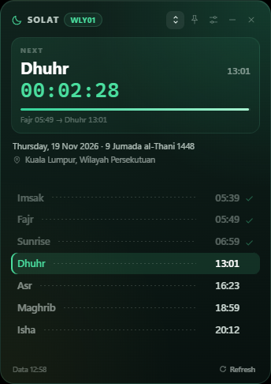
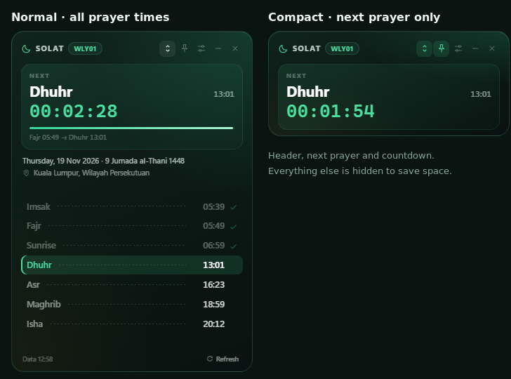
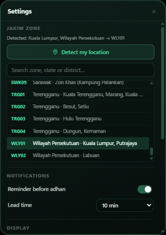

# Solat Widget — User Manual

Everything you need to run and use **Solat Widget**, a small always-on-top card
that shows Malaysian prayer times from the official JAKIM e-Solat timetable.

For the technical internals, see [`ARCHITECTURE.md`](./ARCHITECTURE.md).

---

## 1. What it is

Solat Widget is a small window that floats over your desktop and shows:

- the **next prayer** and a live countdown to it,
- today's full timetable (Imsak, Fajr, Sunrise, Dhuhr, Asr, Maghrib, Isha),
- today's Gregorian and Hijri dates,
- a reminder notification before each prayer, if you want it.

The interface is in **English by default**; Bahasa Melayu is available under
*Settings → Display → Language*. The widget can be shown as the full **normal**
card or as a **compact** card that keeps only the next prayer.

Times come straight from JAKIM's e-Solat API for the zone you choose, so they
match the official timetable, the mosque's printed schedule and apps like
eSolat/eDoa.

**Requirements:** Windows 10 or 11. It works fully offline for a while thanks
to a local cache, but it needs internet to refresh.

---

## 2. Installing

Two options come with each release:

| File | Use it when |
|---|---|
| `SolatWidget-1.1.0-portable.exe` | You want it now, no installation. Just double-click it. |
| `Solat Widget Setup 1.1.0.exe` | You want a Start-menu/desktop shortcut and "Start with Windows" to work properly. |

Because the builds are not code-signed, the **first** launch shows a
SmartScreen message:

> *Windows protected your PC — Microsoft Defender SmartScreen prevented an
> unrecognized app from starting.*

Click **More info → Run anyway**. This is normal for any unsigned personal
build and only appears on first launch.

### First run

1. The widget appears in the **bottom-right corner** of your desktop.
2. It automatically guesses your JAKIM zone from your network location — for
   example, an IP in Kuala Lumpur resolves to `WLY01`.
3. It fetches the timetable and starts counting down.

If it picked the wrong zone, see [§6 Changing your zone](#6-changing-your-zone).

---

## 3. The main screen



| # | Element | What it means |
|---|---|---|
| 1 | ☾ **SOLAT** | Title. The whole card is draggable from anywhere except buttons |
| 2 | `WLY01` chip | Your current JAKIM zone — click it to change zone |
| 3 | Compact button | Switch between the normal and compact card (also in Settings and the tray) |
| 4 | Pin | Toggle "always on top" (glows green when pinned) |
| 5 | Sliders | Open the settings panel |
| 6 | `—` | Hide the widget into the system tray |
| 7 | `×` | Close the app completely (it does **not** hide to tray) |
| 8 | **NEXT** | Header for the next prayer |
| 9 | **Dhuhr** + `13:01` | The prayer that is next, and its time today |
| 10 | `00:02:28` | Live countdown to that prayer |
| 11 | Thin progress bar | How far through the current prayer window you are (Fajr → Dhuhr) |
| 12 | `Fajr 05:49 → Dhuhr 13:01` | The prayer window you are currently in |
| 13 | `Thursday, 19 Nov 2026 · 9 Jumada al-Thani 1448` | Today's date and the Hijri date |
| 14 | `📍 Kuala Lumpur, Wilayah Persekutuan` | The location your zone was detected from |
| 15 | Prayer rows | Today's timetable; ✓ marks prayers that have passed; the highlighted row is the next prayer |
| 16 | `Data 12:58` | When the data was last resolved; `cache` means it came from the local cache |

### Reading the times

- **Imsak** and **Sunrise** are *informational* — they are not prayers. Imsak is
  ~10 minutes before Fajr; Sunrise (Syuruk) is when the sun rises. You can hide
  both in settings.
- The five that count as prayers are **Fajr, Dhuhr, Asr, Maghrib, Isha**.
  The countdown only ever targets one of these five.
- **After Isha**, the widget automatically counts down to *tomorrow's* Fajr.

### Different looks



Left: the **normal** card with the full timetable.
Right: the **compact** card, which keeps the header, the next prayer and the
countdown, and hides everything else. Toggle it with the button in the header,
the *Compact card* switch in settings, or the tray menu.

The 12-hour format (`AM`/`PM`, or `PG`/`PTG` in Malay) and the language are
separate settings under *Display*.

---

## 4. Status badges and the footer

The last line of the card tells you how fresh the data is:

| Text | Meaning |
|---|---|
| `Data 16:25` | Fetched live from JAKIM at 16:25 |
| `Data 16:25 · cache` | Loaded from the local cache (normal after a restart within 6 hours) |
| `Data 16:25 · cache · offline` | The live fetch failed and the timetable shown is the last cached one — check your internet connection |
| `Data 16:25 · MYT time` | Your PC's clock is not in Malaysia Time (UTC+8); times are still shown in Malaysian time |
| `Fetching JAKIM data…` | Fetching right now |
| An error message | The API could not be reached or the response was invalid |

There is also a small `Cache` badge in the hero area whenever the timetable is
coming from the cache rather than a live fetch.

---

## 5. The tray icon

The widget lives in the **system tray** (bottom-right, next to the clock):

- **Left-click** the icon → show/hide the widget.
- **Hover** it → the tooltip shows the next prayer and live countdown.
- **Right-click** it → a menu with:

```
Fajr 05:49 (07:12:03)      ← live countdown
Zone: WLY01 · Wilayah Persekutuan
──────────────────────────
Show Widget
Refresh Data
──────────────────────────
Compact Size           ✓
Always on Top          ✓
Start with Windows
Adhan Notifications    ✓
──────────────────────────
Quit
```

> **Windows 11 tip:** new tray icons start hidden inside the overflow menu (the
> `^` chevron next to the clock). Click the chevron and drag the widget's
> crescent icon onto the taskbar if you want it permanently visible.

`—` on the card and the tray both hide the widget; only `×` (or *Quit*)
actually exits it. The tray menu follows the language of the card.

---

## 6. Changing your zone

Click the **zone chip** (`WLY01`) or the sliders icon to open settings:



In **JAKIM zone**:

1. Type in the search box — it matches zone code, state name and district
   names (`ampang`, `kuala lumpur`, `wly`, …).
2. Click a row to switch immediately. The widget refetches for that zone.
3. Or click **Detect my location** to re-run the automatic detection and see
   which location it resolved (`Detected: Kuala Lumpur, Wilayah Persekutuan → WLY01`).

All 60 official JAKIM zones are available. The automatic detection is
city-level, so near a state border it may be one district off — just pick
manually in that case. Your choice is remembered; the app does not re-detect
on later launches.

---

## 7. Settings explained

| Control | What it does |
|---|---|
| **Detect my location** | Re-detect your zone from your IP address |
| **Zone search + list** | Pick any of the 60 zones manually |
| **Reminder before adhan** | Turn the reminder toasts on/off |
| **Lead time** | How long before the azan you get notified: at adhan, 5, 10, 15, 20 or 30 minutes |
| **Always on top** | Pin the card above all other windows |
| **Show Imsak** | Show/hide the Imsak row |
| **Show Sunrise** | Show/hide the Sunrise row |
| **12-hour format (AM/PM)** | `18:58` ↔ `6:58 PM` (`6:58 PTG` in Malay) |
| **Compact card** | Show only the header, next prayer and countdown |
| **Language** | English (default) or Bahasa Melayu — applies to the card, settings, tray and notifications |
| **Start with Windows** | Launch the widget (hidden in the tray) at login — *only available on the installed/portable build, not in dev mode* |
| **To tray** | Hide the card now |
| **Quit** | Quit the app |

Settings apply instantly and are saved to
`%APPDATA%\solat-desktop-widget\config.json`.

---

## 8. Prayer notifications

- You get one Windows notification per prayer, by default **10 minutes
  before** the azan, e.g. *"Maghrib in 10 min — Maghrib 18:58 · WLY01 ·
  Wilayah Persekutuan"*.
- It fires **once**. Closing the widget, restarting Windows or the app will not
  re-trigger it for the same prayer.
- Clicking the notification brings the widget back up.
- If you do not see notifications: check **Settings → System → Notifications**
  for "Solat Widget", and make sure **Focus Assist / Do Not Disturb** is not
  silencing them.

---

## 9. Everyday actions

| Action | How |
|---|---|
| Move the widget | Drag it from any empty area (the whole card is a handle) |
| Switch to compact / normal | Compact button in the header, *Compact card* in settings, or *Compact Size* in the tray |
| Change language | *Settings → Display → Language* |
| Force a data refresh | `Refresh` in the footer, or the tray menu |
| Hide it for a while | `—`, the tray icon, or *To tray* in settings |
| Bring it back | Click the tray icon |
| Quit for good | `×` or *Quit* in settings, or *Quit* in the tray menu |
| Open it again | Run the exe again — a second copy will not start; the existing widget is shown instead |

Its position is remembered between sessions. If a monitor is unplugged and the
widget lands off-screen, it re-anchors itself to the bottom-right.

---

## 10. Troubleshooting

| Problem | Cause & fix |
|---|---|
| `offline` badge / no times | No internet, or JAKIM is unreachable. The widget keeps showing the last cached timetable. Check your connection and click `Refresh` |
| Wrong zone after first run | IP geolocation is approximate. Open settings → search for your state/district → click the row |
| Widget not staying on top | The pin toggle is off (pin icon in the header, or *Always on top* in settings) |
| No notifications | Check Windows notification settings for "Solat Widget", Focus Assist, and that *Reminder before adhan* is on |
| Tray icon missing | Windows 11 hides new icons in the `^` overflow — drag it out (§5) |
| Times differ from my phone app | Confirm the zone matches your district (§6); also confirm your device clock/timezone is correct |
| Widget disappeared entirely | It is in the tray — click the tray icon. If the icon is gone, run the exe again |
| Widget stuck on "Fetching JAKIM data…" | The e-Solat API may be down. It will retry automatically every 3 hours and at midnight |

---

## 11. Privacy and data

**What leaves your computer:**

1. HTTPS requests to `e-solat.gov.my` (the JAKIM timetable) — no personal data
   beyond your IP, which is inherent to any web request.
2. One HTTPS/HTTP request to an IP geolocation service (ipwho.is → ipapi.co →
   ip-api.com) — only when detecting your zone.

**What is stored on your computer:**

```
%APPDATA%\solat-desktop-widget\
├─ config.json      your settings (zone, toggles, window position)
└─ data\*.json      cached JAKIM responses
```

No accounts, no telemetry, no analytics. Deleting that folder resets the widget
to first-run state.

---

## 12. Uninstalling

- **Installer build:** Windows Settings → Apps → *Solat Widget* → Uninstall.
- **Portable build:** delete `SolatWidget-1.1.0-portable.exe`.
- Then optionally delete `%APPDATA%\solat-desktop-widget\` to remove your
  settings and cache.

---

## 13. FAQ

**Is this the official JAKIM app?**
No. It is an unofficial widget that reads JAKIM's own e-Solat API, so the times
are the official ones, but the app itself is not affiliated with JAKIM.

**Does it need internet?**
To refresh, yes. A cached timetable keeps working without it and is marked
`offline` until it can refresh.

**Why is my zone different from my friend's?**
JAKIM splits each state into districts. Fajr and Maghrib can differ by a
minute or two between them. Pick the zone for your district (§6).

**Can I use it outside Malaysia?**
The widget works, but automatic zone detection only applies to Malaysian IPs.
Choose your zone manually. If your PC's clock is not on UTC+8, times are still
displayed in Malaysian time and marked `MYT time`.

**Does it update itself?**
No. It refreshes the *timetable* automatically (midnight, every 3 hours, on
launch), but the app itself is updated by downloading a new build.
